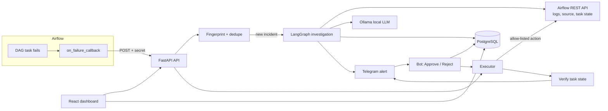
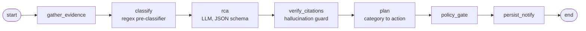
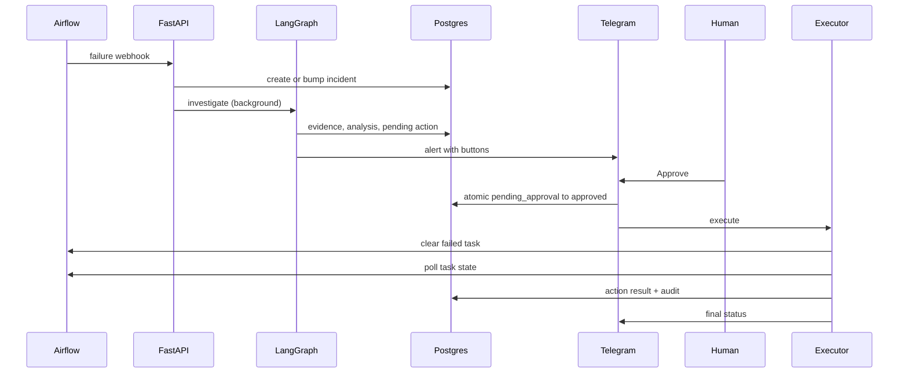

# DagInquest

*Formal investigation of DAG failures.*

A self-hosted agent that investigates failed Apache Airflow runs with a **local LLM (Ollama)**, explains the root cause with evidence, asks a human to **approve on Telegram or the dashboard**, runs only **allow-listed fixes**, and **verifies recovery**. No paid APIs, no cloud dependency.

> **Status labels used in this document:** **[V]** verified in research, **[E]** estimate, **[A]** assumption or design choice. Re-check versions, licenses, and Airflow API paths against your own setup before release.

---

## Table of contents

1. [What it does](#1-what-it-does)
2. [How it differs from existing tools](#2-how-it-differs-from-existing-tools)
3. [Scope: MVP, intermediate, advanced](#3-scope)
4. [System design](#4-system-design)
5. [Tech stack](#5-tech-stack)
6. [Requirements](#6-requirements)
7. [Repository structure](#7-repository-structure)
8. [Quick start](#8-quick-start)
9. [Configuration](#9-configuration)
10. [How to build this project (overview)](#10-how-to-build-this-project)
11. [Agent design](#11-agent-design)
12. [API reference](#12-api-reference)
13. [Telegram bot](#13-telegram-bot)
14. [Data model](#14-data-model)
15. [Evaluation benchmark](#15-evaluation-benchmark)
16. [Testing strategy](#16-testing-strategy)
17. [Security, observability, recovery](#17-security-observability-recovery)
18. [Roadmap and timeline](#18-roadmap-and-timeline)
19. [Troubleshooting](#19-troubleshooting)
20. [Resume and interview notes](#20-resume-and-interview-notes)
21. [License and attributions](#21-license-and-attributions)

---

## 1. What it does

When an Airflow task fails:

1. A failure callback posts the failure to the DagInquest API.
2. The API fingerprints the error and **deduplicates** repeats within a cooldown window.
3. A LangGraph investigation gathers evidence (task log, DAG source), redacts secrets, pre-classifies with regex rules, then asks the local LLM for a structured root-cause analysis.
4. Every log line the LLM cites is **checked against the stored log**. Invented citations lower confidence.
5. A policy gate decides whether a fix may be proposed. Every write action needs **human approval**.
6. A Telegram alert shows the cause, evidence, and **Approve / Reject** buttons.
7. After approval, the executor runs an allow-listed Airflow action (for example, clear the failed task) and **polls until the task reaches a terminal state**.
8. Everything is written to an append-only audit log and shown in the React dashboard.

**Example alert:**

```
Incident #12  etl_daily.load_sales
Category: TRANSIENT_NETWORK   Confidence: 0.82
Cause: SFTP connection timed out after 30s
> socket.timeout: timed out
Policy: allow-listed action; approval required
[Approve retry] [Reject]
```

## 2. How it differs from existing tools

Several open-source Airflow failure agents already exist **[V]**, so DagInquest does not claim to be the first. It competes on engineering quality:

| Differentiator | What it means |
|---|---|
| **Measured accuracy** | A failure-injection benchmark (target 25-30 cases) reports root-cause accuracy, citation validity, and inconclusive rate **per local model**. |
| **Broad failure coverage** | Import errors, timeouts, bad SQL, missing connections, resource exhaustion, upstream data issues. Each has its own remediation policy. |
| **Approval-gated, verified remediation** | Allow-list enforced twice, atomic approval, idempotent actions, post-fix state check. |
| **Telegram-native approvals** | Authenticated callbacks, chat allow-list, audit trail. |
| **Fully local-first** | Ollama only. No OpenAI, Anthropic, or Gemini keys. |

Suggested positioning: *"an evaluated, approval-gated, fully local Airflow incident agent with a published benchmark of how reliable small local models are at root-cause analysis."*

## 3. Scope

| Level | Includes | Estimated effort **[E]** |
|---|---|---|
| **MVP** | Callback, webhook, evidence fetch, regex pre-classifier, LLM RCA, Telegram alert, Postgres storage | 2-3 weeks |
| **Intermediate** | Approvals, allow-listed executor, recovery verification, dedupe, dashboard, audit log | 3-4 weeks |
| **Advanced** | 25-30 case benchmark across models, correlated-failure grouping, Langfuse tracing, similar-incident retrieval (pgvector), optional n8n | 3-4 weeks |

Total: roughly 8-11 weeks part-time **[E]**.

Deliberately **not** in the MVP: Redis, Qdrant, Celery, OpenLineage, dbt, n8n. Add them only when a real need appears.

## 4. System design

### 4.1 Component architecture



### 4.2 Investigation graph (LangGraph)



Design choice **[A]**: the graph **investigates and stores a pending action**; the executor runs **separately after approval**. This keeps approval atomic and idempotent. Upgrade path: add a LangGraph Postgres checkpointer and `interrupt` for resumable runs.

### 4.3 Approval and execution sequence



### 4.4 Key design decisions

| Decision | Reason |
|---|---|
| Regex pre-classifier before the LLM | Small local models are unreliable on long multi-step reasoning. Deterministic rules cover common cases cheaply. |
| Structured JSON output with a schema | Reduces malformed output. Validated with Pydantic. |
| `INCONCLUSIVE` is a valid category | Prevents forced guessing. |
| Citation check against stored log | Measurable hallucination guard. |
| Single atomic `UPDATE ... WHERE status='pending_approval'` | Double clicks and race conditions cannot run an action twice. |
| Allow-list checked in policy **and** executor | Second line of defense. |
| Plain SQL (psycopg), no ORM | Explicit, easy to test and explain. |
| Telegram long polling | No public URL needed for local development. |
| One agent framework (LangGraph) | Explicit state, audit-friendly. CrewAI adds less control; AutoGen is archived **[V]**. |

### 4.5 Failure handling

| Failure | Behavior |
|---|---|
| Airflow API unreachable during evidence fetch | Falls back to the error text sent by the callback. |
| Ollama down or invalid JSON | Falls back to the regex category with low confidence, or `INCONCLUSIVE`. |
| Investigation crashes | Audit entry plus a Telegram message with the last error line. Never silent. |
| Action fails | Action marked `failed`, incident `needs_attention`, Telegram notified. |
| Duplicate failure inside cooldown | Existing incident's `occurrences` incremented, no new alert. |

## 5. Tech stack

| Layer | Choice | Why | License **[V/A]** |
|---|---|---|---|
| Language | Python 3.12 | Matches Airflow, LangGraph, FastAPI | PSF |
| API | FastAPI + Uvicorn | Async, typed, auto docs | MIT |
| Validation/config | Pydantic, pydantic-settings | Schema-checked LLM output, env config | MIT |
| Agent orchestration | LangGraph | Explicit state graph, persistence path | MIT |
| Local LLM runtime | Ollama | Local inference, structured output | MIT |
| Models | Qwen3 8B default; Llama or Gemma variants for comparison | Fits consumer hardware | **Model weights have their own licenses. Check each before redistributing.** |
| HTTP client | httpx | Async | BSD |
| Database | PostgreSQL 16 | Source of truth, audit, JSONB | PostgreSQL License |
| DB driver | psycopg 3 + psycopg_pool | Async, no ORM | LGPL-3.0 |
| Bot | python-telegram-bot | Commands, inline buttons | LGPL-3.0 |
| Pipeline target | Apache Airflow 3 | The system being investigated | Apache 2.0 |
| Frontend | React 18 + TypeScript + Vite | Dashboard | MIT |
| Packaging | Docker Engine + Compose | Reproducible local stack | Apache 2.0 (Docker Desktop has separate commercial terms) |
| CI | GitHub Actions | Lint, tests, frontend build | n/a |
| Lint/test | ruff, pytest, pytest-asyncio | Quality gates | MIT |

**Optional or later:** Langfuse (tracing, core MIT, `ee` folder separate), pgvector (similar-incident search), n8n (self-hosted only; uses the Sustainable Use License, which is **source-available, not OSI open source**).

**Avoided on purpose:** Redis (license changed across versions; use Valkey if a queue is needed), Celery, Qdrant, any paid API or SaaS.

## 6. Requirements

### Software

| Tool | Version | Notes |
|---|---|---|
| Docker + Docker Compose | recent | Runs Postgres, Ollama, Airflow, API, bot |
| Python | 3.12+ | Only needed for the scaffold script and local tests |
| Node.js | 20+ | Dashboard |
| Git | any | Version control |
| `make` | optional | Not required on Windows; use the `docker compose` commands |

### Accounts and keys

| Item | Cost | Notes |
|---|---|---|
| Telegram bot token | Free | Create via @BotFather |
| Your Telegram chat ID | Free | Needed for the allow-list |
| GitHub account | Free | Hosting the repo |
| Paid API keys | **None** | Not used anywhere |

### Hardware **[E]**

| Model size | RAM or VRAM | Notes |
|---|---|---|
| 3-4B quantized | 4-8 GB | Weak at RCA; useful for testing the pipeline |
| 7-8B quantized | about 8-16 GB | Default. CPU-only works but is slow |
| 14B quantized | about 12-16 GB VRAM | Better reasoning |
| 32B | 24 GB+ | Comfortable only with a strong GPU |

Disk: at least 20 GB free (images and models). Small local models can hallucinate root causes and are unreliable at multi-turn tool calling, which is why this project uses a pre-classifier, schema output, citation checks, and human approval.

## 7. Repository structure

```
daginquest/
├── README.md
├── WORKFLOW.md                      # step-by-step build guide (generated from the master prompt)
├── docker-compose.yml
├── Makefile
├── .env.example
├── .gitignore
├── .github/workflows/ci.yml
├── docs/
│   ├── architecture.md
│   └── benchmark.md
├── infra/ollama/pull_models.sh
├── airflow/
│   ├── README.md
│   └── dags/
│       ├── _common/callbacks.py     # failure callback -> API
│       ├── demo_import_error.py
│       ├── demo_timeout.py
│       └── demo_bad_sql.py
├── backend/
│   ├── pyproject.toml
│   ├── Dockerfile
│   ├── migrations/001_init.sql
│   ├── tests/
│   └── src/daginquest/
│       ├── main.py                  # FastAPI app + lifespan
│       ├── config.py                # settings from env
│       ├── api/                     # health, webhooks, incidents, actions, metrics
│       ├── agent/
│       │   ├── graph.py, state.py, prompts.py, runner.py
│       │   └── nodes/               # gather_evidence, classify, rca, verify_citations,
│       │                            # plan, policy_gate, persist_notify
│       ├── actions/                 # executor.py, verify.py
│       ├── airflow/client.py        # Airflow REST client
│       ├── db/                      # session.py, repository.py
│       ├── llm/                     # ollama.py, schemas.py
│       ├── policy/rules.py          # allow-list + gate
│       ├── security/redaction.py
│       ├── telegram/                # bot, handlers, notifier, security
│       ├── utils/                   # fingerprint.py, preclassify.py
│       └── eval/                    # run_eval.py, cases/, results/
└── frontend/
    ├── package.json, tsconfig.json, vite.config.ts, index.html
    └── src/
        ├── main.tsx, App.tsx, index.css, types.ts
        ├── api/client.ts
        ├── hooks/usePolling.ts
        ├── components/ConfidenceBadge.tsx
        └── pages/                   # IncidentsPage, ApprovalsPage, MetricsPage
```

## 8. Quick start

**Option A: generate the scaffold (fastest)**

```bash
python create_daginquest.py          # use python3 on Linux or macOS
cd daginquest
cp .env.example .env                 # Windows CMD: copy .env.example .env
# edit .env: TELEGRAM_BOT_TOKEN, TELEGRAM_ALLOWED_CHAT_IDS, WEBHOOK_SECRET
docker compose up -d --build
docker compose exec ollama ollama pull qwen3:8b
curl http://localhost:8000/api/health
```

**Option B: follow `WORKFLOW.md`** to write every file yourself, step by step. Recommended if you want to understand and be able to explain each part in interviews.

**Then:**

1. Open Airflow at http://localhost:8080 and trigger `demo_import_error` or `demo_timeout`.
2. Watch Telegram for the alert, then approve or reject.
3. Dashboard: `cd frontend && npm install && npm run dev` then open http://localhost:5173.
4. API docs: http://localhost:8000/docs.

## 9. Configuration

All settings live in `.env` (copy from `.env.example`).

| Variable | Default | Purpose |
|---|---|---|
| `POSTGRES_USER` / `POSTGRES_PASSWORD` / `POSTGRES_DB` | `daginquest` style values from the example file | Database credentials |
| `DATABASE_URL` | points to the `postgres` service | App connection string |
| `OLLAMA_URL` | `http://ollama:11434` | Ollama endpoint |
| `OLLAMA_MODEL` | `qwen3:8b` | Model used for RCA |
| `AIRFLOW_IMAGE` | `apache/airflow:3.1.0` | **[A] confirm the tag exists** |
| `AIRFLOW_BASE_URL` | `http://airflow:8080` | Airflow REST base |
| `AIRFLOW_USERNAME` / `AIRFLOW_PASSWORD` | `admin` | API login (check your auth settings) |
| `WEBHOOK_SECRET` | `change-me...` | Shared secret for the failure webhook |
| `TELEGRAM_BOT_TOKEN` | empty | Bot token from @BotFather |
| `TELEGRAM_ALLOWED_CHAT_IDS` | empty | Comma-separated chat IDs allowed to approve |
| `CONFIDENCE_THRESHOLD` | `0.6` | Below this, no action is proposed |
| `DEDUPE_COOLDOWN_MINUTES` | `30` | Window for merging repeat failures |

Airflow containers also receive `DAGINQUEST_API_URL` and `DAGINQUEST_WEBHOOK_SECRET` from `docker-compose.yml`.

## 10. How to build this project

Full detail lives in `WORKFLOW.md`. Overview:

| Phase | Goal | Main paths | Checkpoint |
|---|---|---|---|
| 0 | Repo, tooling, Compose with Postgres, Ollama, Airflow | root files, `docker-compose.yml`, `.env.example` | `docker compose ps` all running |
| 1 | Database schema | `backend/migrations/001_init.sql` | tables exist in Postgres |
| 2 | Backend skeleton and config | `backend/pyproject.toml`, `config.py`, `main.py`, `api/health.py` | `/api/health` returns ok |
| 3 | Utilities: fingerprint, redaction, pre-classifier, policy | `utils/`, `security/`, `policy/` | unit tests pass |
| 4 | DB layer | `db/session.py`, `db/repository.py` | repository functions work against Postgres |
| 5 | Airflow client and demo DAGs with callback | `airflow/client.py`, `airflow/dags/` | demo DAG failure reaches the webhook |
| 6 | LLM client and RCA schema | `llm/` | model returns schema-valid JSON |
| 7 | LangGraph investigation | `agent/` | a failure produces a stored analysis |
| 8 | Telegram alerts, bot, approvals | `telegram/` | alert arrives; buttons work |
| 9 | Executor and recovery verification | `actions/` | approved retry runs and is verified |
| 10 | Dashboard | `frontend/` | incidents and approvals visible |
| 11 | Benchmark | `eval/` | accuracy report per model |
| 12 | Hardening and release | CI, docs, README results | CI green; demo recorded |

**Build rules:** finish and verify each phase before the next. Commit after every checkpoint. Do not add technology the phase does not need.

## 11. Agent design

### Failure categories

| Category | Typical evidence | Auto-remediable? |
|---|---|---|
| `IMPORT_ERROR` | `ModuleNotFoundError`, `No module named` | No (notify, suggest fix) |
| `SCHEMA_SQL` | `column ... does not exist` | No |
| `TRANSIENT_NETWORK` | timeouts, connection reset | Yes, with approval |
| `CONFIG_SECRET` | missing connection or variable, auth failure | No |
| `RESOURCE` | out of memory, disk full | Yes, with approval |
| `UPSTREAM_DATA` | missing file, sensor timeout | No |
| `INCONCLUSIVE` | evidence insufficient | No |

### RCA output schema

```json
{
  "category": "TRANSIENT_NETWORK",
  "root_cause": "SFTP connection timed out after 30s",
  "confidence": 0.82,
  "cited_lines": ["socket.timeout: timed out"]
}
```

### Policy rules

1. Only `retry_task` and `clear_task` are allow-listed.
2. Category must be in the safe set (`TRANSIENT_NETWORK`, `RESOURCE`).
3. Confidence must meet `CONFIDENCE_THRESHOLD`.
4. **Every** write action requires human approval. There is no auto-execute path.

### Hallucination guard

`confidence = confidence x (valid cited lines / total cited lines)`. If no lines are cited for a non-inconclusive result, confidence is halved. Only cited lines found verbatim in the stored log are kept.

## 12. API reference

| Method | Path | Purpose |
|---|---|---|
| GET | `/api/health` | Liveness |
| POST | `/api/webhooks/airflow/failure` | Failure intake. Header `X-Webhook-Secret` required. Returns 202 with `incident_id` and `deduplicated`. |
| GET | `/api/incidents` | Recent incidents |
| GET | `/api/incidents/{id}` | Incident with evidence and actions |
| GET | `/api/actions/pending` | Actions awaiting approval |
| POST | `/api/actions/{id}/approve` | Approve and execute (409 if already decided) |
| POST | `/api/actions/{id}/reject` | Reject (409 if already decided) |
| GET | `/api/metrics` | Counts, dedupe total, average confidence |

Webhook payload:

```json
{"dag_id": "etl_daily", "run_id": "manual__2026-11-24", "task_id": "load_sales", "try_number": 1, "error": "..."}
```

**Note [A]:** the dashboard approve and reject endpoints are unauthenticated in the scaffold. Add authentication before exposing the API beyond localhost.

## 13. Telegram bot

| Command | Action |
|---|---|
| `/start` | Help |
| `/incidents` | Last 10 incidents |
| `/incident <id>` | Details |
| `/status` | Metrics summary |
| Inline buttons | Approve or reject a proposed action |

Only chats listed in `TELEGRAM_ALLOWED_CHAT_IDS` are served. Others are ignored silently. The bot uses long polling, so no public URL is needed.

## 14. Data model

| Table | Purpose |
|---|---|
| `incidents` | One row per distinct failure fingerprint within the cooldown; holds category, cause, confidence, occurrences |
| `evidence` | Redacted logs and DAG source, with content hash |
| `analyses` | Each LLM result with model name, cited lines, raw metadata |
| `actions` | Proposed actions, status, idempotency key (`incident_id:type`, unique) |
| `approvals` | Who decided, through which channel |
| `audit_log` | Append-only; a trigger blocks UPDATE and DELETE |
| `playbooks` | Known fixes by error signature (advanced milestone) |
| `eval_runs` | Benchmark summaries |

Action status flow: `pending_approval` to `approved` or `rejected`; then `succeeded` or `failed`.

## 15. Evaluation benchmark

The benchmark is a **core deliverable**, not an afterthought.

- Cases are JSON files in `backend/src/daginquest/eval/cases/`: `id`, `expected_category`, `log`, optional `dag_source`.
- Run: `python -m daginquest.eval.run_eval --models qwen3:8b llama3.1:8b`
- Output: one JSON report per model in `eval/results/`.

| Metric | Meaning |
|---|---|
| Category accuracy | Share of cases where predicted category equals expected |
| Citation validity | Average share of cited lines that exist in the log |
| Inconclusive rate | Share of `INCONCLUSIVE` answers |
| Latency | Seconds per case |
| Time to diagnose (p50) | Compared with a manual baseline |

**Target suite (25-30 cases):** import errors (3), timeouts (3), bad SQL (3), missing connection or variable (3), auth failure (2), out of memory (2), disk full (1), missing upstream file or sensor timeout (3), ambiguous or noisy logs (3), correlated multi-DAG failures (2).

Publish a results table per model in this README once measured.

## 16. Testing strategy

| Level | What | Where |
|---|---|---|
| Unit | fingerprint stability, redaction, policy rules, pre-classifier, citation ratio | `backend/tests/` |
| Integration | webhook to incident row, dedupe, atomic approval, executor with a mocked Airflow client | to be added |
| End-to-end | trigger a demo DAG, receive alert, approve, see task recover | manual script plus recorded demo |
| LLM eval | benchmark suite per model | `eval/` |
| Idempotency | double approve returns 409; replayed webhook does not duplicate | integration tests |

Run: `cd backend && pip install -e ".[dev]" && pytest`

## 17. Security, observability, recovery

**Security**

- Webhook secret compared in constant time.
- Secrets, tokens, and connection strings redacted **before** text reaches the LLM or storage.
- Telegram chat allow-list; actions authorized per approver.
- Read-only Airflow credentials for evidence fetch; use a separate credential for the executor in production **[A]**.
- Allow-list enforced at policy and executor.
- Never run LLM output as code or SQL. Treat log text as untrusted input (prompt injection risk).

**Observability**

- Structured logs from API, bot, and runner.
- Audit log of every state change.
- Dashboard metrics. Langfuse tracing and Prometheus metrics are optional later additions.

**Recovery**

- Fallback paths in section 4.5.
- Idempotency keys on actions.
- Upgrade path: LangGraph Postgres checkpointer for resumable investigations.

## 18. Roadmap and timeline

| Weeks **[E]** | Goal |
|---|---|
| 1 | Docker Compose with Airflow 3, Postgres, Ollama; demo failing DAGs |
| 2 | Webhook, evidence fetch, storage |
| 3 | First RCA plus Telegram alert (**MVP demo**) |
| 4-5 | Benchmark suite to 25-30 cases |
| 6-7 | Approvals, allow-listed remediation, verification |
| 8 | Dedupe polish, audit log checks |
| 9-10 | Dashboard |
| 11+ | Langfuse tracing, similar-incident retrieval, optional n8n |

## 19. Troubleshooting

| Symptom | Likely cause | Fix |
|---|---|---|
| Airflow image not found | Tag in `AIRFLOW_IMAGE` does not exist | Pick an existing 3.x tag |
| 401 or 404 from Airflow client | Auth config or endpoint path differs | Check `http://localhost:8080/docs`; adjust `airflow/client.py` |
| No Telegram alert | Empty token or chat ID | Set both in `.env`; check `docker compose logs api bot` |
| Bot ignores you | Chat ID not in allow-list | Add your ID to `TELEGRAM_ALLOWED_CHAT_IDS` |
| LLM returns invalid JSON | Model too small | Use a larger model; confirm fallback produces a heuristic result |
| Ollama very slow or killed | Not enough RAM or VRAM | Use a smaller quantized model |
| Demo DAG shows import error for `_common` | DAG folder mount missing | Check the `./airflow/dags` volume in Compose |
| Duplicate alerts | Cooldown too short | Increase `DEDUPE_COOLDOWN_MINUTES` |

## 20. Resume and interview notes

**Resume line:**
*Built DagInquest, a self-hosted Airflow 3 incident-response agent (LangGraph, FastAPI, Ollama) with Telegram approval gates, allow-listed remediation, and a failure-injection benchmark measuring root-cause accuracy across local models.*

**Be ready to explain:**

- Why an explicit graph beats a free-form agent loop.
- How the approval step is atomic and idempotent.
- How hallucination is measured (citation validity) and mitigated.
- Why a regex pre-classifier runs before a small LLM.
- Why n8n, Redis, and a vector database were left out of the core.
- Trade-offs between model sizes, based on your own benchmark numbers.

## 21. License and attributions

Choose a license for this repository before publishing (MIT or Apache-2.0 are common choices). Third-party licenses are listed in section 5. Re-verify them, especially model weight licenses and any optional components, before redistribution.

Check name availability on GitHub and PyPI before publishing the package.