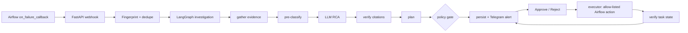

# Architecture

Two phases keep it robust: the graph investigates and stores a pending action;
approval triggers the executor separately (atomic status transition = idempotent).
Upgrade path: add a LangGraph Postgres checkpointer and `interrupt` for resumable runs.
